  <!-- 00 Hero Banner -->
  

 

  <!-- Hero Link Pills -->
  

 

  <!-- 01 About Card (AI-Focused) -->
  

 

  <!-- 02 Selected Work: Echo Sight (1st Project) -->
  

 

  <!-- 02 Selected Work: NeuralKPI / Campus OS (2nd Project) -->
  

 

  <!-- 02 Selected Work: PRISM (3rd Project) -->
  

 

  <!-- 03 Experience Card -->
  

 

  <!-- 04 Technical Arsenal Card -->
  

 

  <!-- 05 Repository Telemetry & Contribution Stream -->
  

  

  <!-- 07 Animated Footer -->
  

