  <!-- 00 Hero Banner -->
  

 

  <!-- HUD Status Bar -->
  

 

  <!-- Direct Contact Bar -->
  
  &nbsp;&nbsp;
  
  &nbsp;&nbsp;
  

 

  <!-- 01 Executive Overview Card -->
  

 

  <!-- 02 Industry Experience Card -->
  

 

  <!-- 03 Featured Engineering Projects Card -->
  

  

    <a href="https://github.com/Harish-628/PRISM"><b>[ 🚨 PRISM Core ]</b></a>
    &nbsp;&nbsp;•&nbsp;&nbsp;
    <a href="https://github.com/Harish-628/Echo-Sight"><b>[ 👁️ Echo Sight ]</b></a>
    &nbsp;&nbsp;•&nbsp;&nbsp;
    <a href="https://github.com/Harish-628/NeuralKPI"><b>[ 🧠 NeuralKPI ]</b></a>
    &nbsp;&nbsp;•&nbsp;&nbsp;
    <a href="https://github.com/Harish-628/Bharat-AI-Assistant"><b>[ 📱 Bharat AI ]</b></a>
  

 

  <!-- 04 Technical Arsenal Card -->
  

 

  <!-- 05 Milestones Card -->
  

 

  <!-- 06 GitHub Genuine Contribution Heatmap -->
  
    
  

  

  <!-- 07 Animated Footer -->
  

