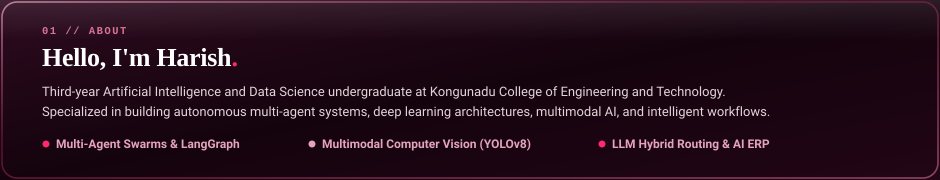
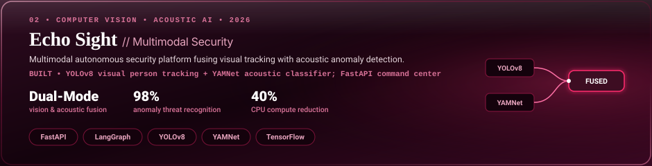
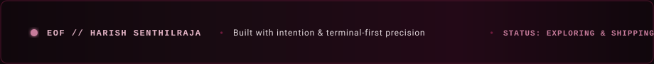

  <!-- 00 Hero Banner -->
  

 

  <!-- Hero Link Pills -->
  

 

  <!-- 01 About Card -->
  

 

  <!-- 02 Selected Work: PRISM -->
  

 

  <!-- 02 Selected Work: Echo Sight -->
  

 

  <!-- 02 Selected Work: NeuralKPI -->
  

 

  <!-- 03 Experience Card -->
  

 

  <!-- 04 Technical Arsenal Card -->
  

 

  <!-- 05 Milestones Card -->
  

 

  <!-- 06 GitHub Genuine Contribution Heatmap -->
  
    
  

  

  <!-- 07 Animated Footer -->
  

